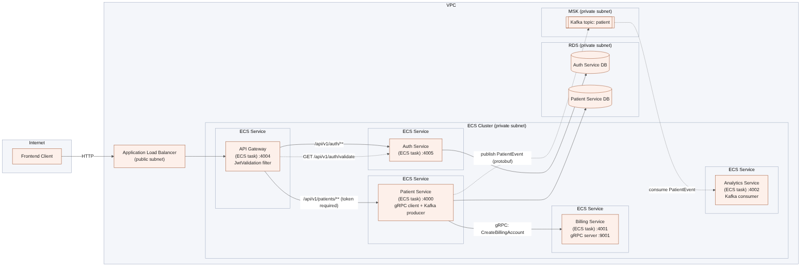
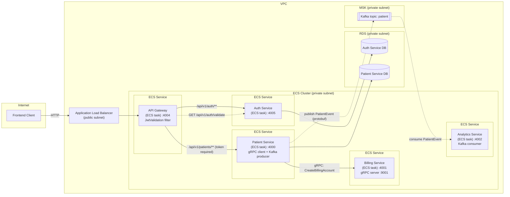
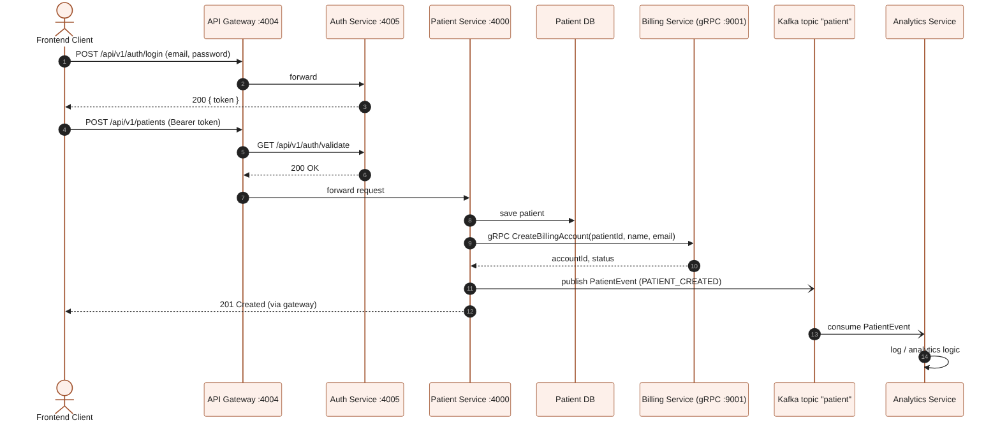

# Architecture

How the services are meant to work together (target ECS deployment).

## Request flow: login, then create a patient

## Notes

- Only the API Gateway is exposed (via the load balancer). Auth, Patient, Billing and Analytics are internal.
- The gateway's `JwtValidation` filter calls `GET /api/v1/auth/validate` before forwarding `/api/v1/patients/**`. `/api/v1/auth/**` is open so users can log in.
- Creating a patient: save to the Patient DB, call Billing over gRPC, then publish a `PatientEvent` to the `patient` Kafka topic. Analytics consumes it.
- Running locally with Docker Compose, the same services run as containers on the `internal` network (gateway on `localhost:4004`, Postgres on 5001/5002, Kafka on 9092/9094). RDS, ECS, the load balancer and MSK in the diagram are replaced by Compose services.
- Source files: `architecture.mmd` and `create-patient-sequence.mmd`. Re-render with `mmdc -i <file>.mmd -o <file>.png -s 2`.
